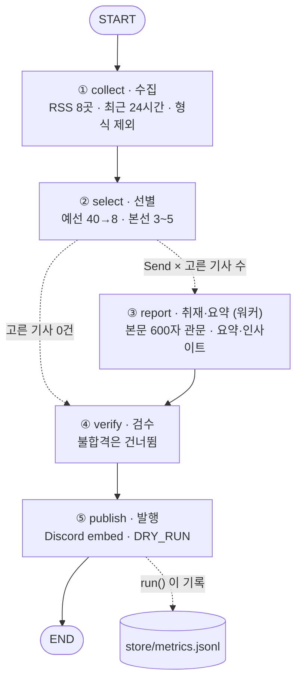

# 비즈 브리핑 — 프로젝트 수행 결과 보고서

기획·재무 의사결정을 위한 경제·기업 뉴스 3~5건을 매일 아침 골라 Discord로 보내는 LangGraph 에이전트.
레포: https://github.com/rubilisa08/biz-briefing-agent · 사용법과 파일 구조는 [README.md](README.md)

---

## 1. 분야 및 독자 정의

### 어떤 분야인가요?
**비즈니스 의사결정을 위한 경제·기업 뉴스** — 기획과 재무를 합친 관점이에요.
기업 실적, 산업 변화, 경제지표를 보고 **기업에 어떤 기회와 위험이 생기는지** 설명하는 뉴스레터예요.

예를 들면 이런 뉴스를 다뤄요.
- 삼성전자 실적 변화가 사업 전략에 미치는 영향
- 금리 변화가 기업의 자금 조달에 미치는 영향

### 왜 이 분야를 골랐나요?
경제 뉴스는 많지만, 기획·재무 실무에서 필요한 건 결국 **"그래서 우리 회사의 매출·비용·자금 조달에 무슨 일이 생기나?"** 라는 한 가지 질문이에요.
기사를 많이 읽는 것보다, **의사결정에 닿는 몇 건을 매일 같은 질문으로 읽는 습관**이 더 중요하다고 봤어요.

### 누가 읽나요? (타깃 독자 페르소나)

| 항목 | 내용 |
|---|---|
| 👤 누구 | 경제·경영에 관심 있는 **취업준비생**, **주니어 기획·재무 담당자** |
| 💼 어울리는 직무 | 사업기획, 경영기획, 재무기획(FP&A) |
| ⏰ 언제 읽나 | 출근·등교 전 아침 5분 |
| 🎯 얻고 싶은 것 | 오늘 기업 환경에 영향을 줄 뉴스를 빠르게 파악하고, 면접·보고서에서 쓸 **관점**을 얻는 것 |

### 뉴스를 읽을 때 던지는 4가지 질문
1. **무슨 일이 일어났는가?**
2. **왜 중요한가?**
3. **기업의 매출·비용·수익성·전략에 어떤 영향을 미칠 수 있는가?**
4. **앞으로 무엇을 주목해야 하는가?**

### 다루는 뉴스 4가지 카테고리

| 카테고리 | 다룰 내용 | 핵심 분석 질문 | Discord 카드 색 |
|---|---|---|---|
| 🔵 경제 지표 | 금리, 물가, 환율, 소비 | 기업 환경이 어떻게 바뀔까? | 파랑 |
| 🟢 기업 실적 | 매출, 영업이익, 현금흐름 | 기업의 수익성은 왜 변했을까? | 초록 |
| 🟠 산업·경쟁 | AI, 반도체, 유통, 금융 | 어떤 기업이 기회를 얻을까? | 주황 |
| 🟣 경영 의사결정 | 투자, 비용 절감, 신사업 | 기업은 어떤 선택을 해야 할까? | 보라 |

> 💡 독자·질문·카테고리·키워드는 모두 [`audience.yaml`](audience.yaml) 한 파일에 있어요. **코드를 고치지 않고 이 파일만 바꿔도** 선별 기준이 바뀌어요.

---

## 2. 소스 채택표

### 어떻게 골랐나요?
"유명한 매체"가 아니라 **실제로 요청을 보내서 잰 숫자**로 골랐어요.
[`scripts/probe_sources.py`](scripts/probe_sources.py)가 후보 15곳에 접속해 아래 값을 재고, 결과를 [`store/source_probe.json`](store/source_probe.json)에 저장해요.
과제 제외 목록(OpenAI · DeepMind · TechCrunch · The Verge · MIT TR · AI타임스)은 처음부터 후보에서 뺐어요.

### 통과해야 하는 관문 4개

| 관문 | 기준 | 왜 필요한가 |
|---|---|---|
| 🚪 G3 접근 | HTTP 200 응답 | 주소가 없거나 막혀 있으면 아예 못 가져와요 |
| ⏱ G2 생존 | 최근 24시간 안 글 **5건 이상** | 매일 아침 보내는데 새 글이 없으면 소용없어요 |
| 📄 G1 본문 | 최근 3건 중 **2건 이상** 본문 600자 이상 추출 | 요약·검수할 재료(원문)가 있어야 해요 |
| ✏️ 요약 길이 | 피드 요약 길이 **중앙값 80자 이상** | 지금(무료판)은 매체가 피드에 준 요약을 그대로 발행해요 |

### 측정 결과 (2026-10-29 17시)

"피드 요약"은 피드에 있는 모든 글의 요약 길이 **중앙값**이에요. 첫 글 하나만 재면 날마다 들쭉날쭉해서 중앙값으로 바꿨어요.

| 소스 | HTTP | 24시간 건수 | 피드 요약 (중앙값) | 최신 글 | 본문 추출 | 판정 | 이유 |
|---|---|---|---|---|---|---|---|
| 한국은행 보도자료 | 200 | 2 | 95자 | 5.2시간 전 | 0/3 | ✅ 채택 (예외) | 금리·물가의 **1차 소스**. 본문이 첨부 파일이라 추출은 안 되지만, 피드 글에 금리·수치가 들어 있어요. 그래서 피드 글을 본문으로 쓰고, 본문 기준을 600자 대신 **150자**로 따로 둬요 |
| 연합뉴스 경제 | 200 | 120 | 83자 | 0.2시간 전 | 3/3 | ✅ 채택 | 모든 관문 통과, 경제 지표 기사가 많아요 |
| 연합뉴스 산업 | 200 | 120 | 83자 | 0.1시간 전 | 3/3 | ✅ 채택 | 모든 관문 통과, 산업·기업 기사 |
| 매일경제 경제 | 200 | 37 | 102자 | 방금 | 3/3 | ✅ 채택 | 모든 관문 통과 |
| 매일경제 기업 | 200 | 50 | 102자 | 0.1시간 전 | 3/3 | ✅ 채택 | 기업 실적·경영 기사 |
| 머니투데이 | 200 | 100 | 379자 | 방금 | 3/3 | ✅ 채택 | 요약이 길어 무료판에 좋아요 |
| 아시아경제 | 200 | 100 | 299자 | 방금 | 3/3 | ✅ 채택 | 모든 관문 통과 |
| 뉴시스 경제 | 200 | 100 | 1,056자 | 0.1시간 전 | 2/3 | ✅ 채택 | 요약이 가장 풍부해요 |
| 한국경제 경제 | 200 | 50 | **0자** | 1.1시간 전 | 3/3 | ❌ 탈락 | 피드에 요약이 없어서 무료판으로는 보낼 내용이 없어요 (LLM 요약을 붙이면 다시 검토) |
| 한국경제 금융 | 200 | 50 | **0자** | 0.3시간 전 | 3/3 | ❌ 탈락 | 위와 같아요 |
| 조선비즈 | 200 | 100 | **0자** | 0.1시간 전 | 3/3 | ❌ 탈락 | 위와 같아요 |
| 이데일리 | 200 | **0** | 202자 | **27.5시간 전** | 3/3 | ❌ 탈락 | 피드 갱신이 늦어 24시간 안 글이 없어요 (G2) |
| CNBC Economy | 200 | 3 | 124자 | 10.7시간 전 | 3/3 | ❌ 탈락 | 영어 기사 — 국내 독자 대상인데 무료판은 번역을 못 해요 |
| 한국경제 산업 | **404** | – | – | – | – | ❌ 탈락 | 주소가 없어요 (G3) |
| 정책브리핑 기재부 | **404** | – | – | – | – | ❌ 탈락 | 주소가 없어요 (G3) |

**결론: 15곳 중 8곳 채택** (1차 소스 1곳 + 경제 매체 7곳) → 하루 약 550건 수집

> 연합뉴스·매일경제는 섹션(경제 / 산업·기업)별로 두 개씩 채택했어요. 섹션마다 다루는 기사가 달라서 네 카테고리를 고루 채우는 데 도움이 돼요.

---

## 3. 선별 로직 설계

### 중요도 판단 문장
모든 선별 기준은 이 한 문장에서 나와요.

> **"이 뉴스가 기업의 매출·비용·수익성·자금조달·전략 판단을 바꿀 만한가.**
> **숫자(지표·실적)로 확인되는 변화일수록, 여러 기업에 동시에 영향을 줄수록 중요하다."**

### 점수는 이렇게 매겨요

| 요소 | 점수 | 예시 | 이유 |
|---|---|---|---|
| 제목에 카테고리 키워드 | **+2** / 개 | "영업이익", "환율", "인수" | 제목에 나온 주제가 기사의 중심이에요 |
| 요약에 카테고리 키워드 | **+1** / 개 | | 보조 근거예요 |
| 숫자 신호 | **+2** | "680억원", "0.9원", "19%" | 중요도 문장의 "숫자로 확인되는 변화" |
| 홍보성 표현 | **−3** | "MOU", "협약", "수상", "기부" | 의사결정 재료가 아니에요 |
| 제외 형식 | 수집 단계에서 제외 | [포토], [부고], [인사], [사설] | 발행할 가치가 없는 형식이에요 |

점수가 가장 높은 카테고리가 그 기사의 **카테고리 라벨**이 되고, 점수에 걸린 키워드가 **근거 라벨**로 남아요.
겹치는 키워드는 한 번만 세요. 예를 들어 "소비자물가"가 걸리면 그 안의 "물가"·"소비"는 다시 세지 않아요.

### 예선 → 본선 2단계 구조

```
약 550건 ──(40건씩 묶음)──▶ 묶음마다 상위 8건 [예선] ──▶ 약 110건 ──(한 번에 비교)──▶ 3~5건 [본선]
```

한 번에 550건을 비교하지 않고 두 단계로 나눈 이유는, **나중에 LLM이 고르게 바꿨을 때 목록이 너무 길면 가운데 있는 기사를 놓치기 때문**이에요 (lost in the middle).
지금(무료판)도 같은 구조를 써서, LLM으로 바꿀 때 고르는 함수 하나만 갈아 끼우면 되게 해 뒀어요.

| 설정 | 값 | 왜 이 값인가 |
|---|---|---|
| 묶음 크기 `batch` | **40** | 제목 40개면 한 화면·한 번의 LLM 호출에 무리 없이 들어가요 |
| 예선 통과 수 `prelim_per_batch` | **8** | 최종 5건보다 넉넉히 올려야 본선에서 카테고리·매체 균형을 맞출 여유가 생겨요 |
| 최종 건수 `target` | **5** | 과제 기준 3~5건, 아침 5분 분량 |
| 최저 점수 `min_score` | **3** | 기준에 못 미치는 날엔 억지로 5건을 채우지 않아요 |
| 매체당 최대 `per_source` | **2** | 한 매체가 지면을 독점하지 않게 |
| 카테고리당 최대 `per_category` | **2** | 실적 기사만 5건 오는 날을 막아요 |
| 같은 사건 | **1건만** | 회사·기관 이름처럼 **고유한 낱말**이 40% 이상 겹치면 같은 사건으로 봐요 (예: 같은 회사 실적을 두 매체가 보도). "3분기·영업이익·기준금리·동결"처럼 어느 기사에나 나오는 말과 숫자는 빼고 비교해요 |

### "기준대로 골랐다"는 증거
GitHub Actions에서 실행할 때마다 [`store/metrics.jsonl`](store/metrics.jsonl)에 한 줄씩 기록이 쌓여요. 실패한 실행도 오류 내용과 함께 남아요.
(내 PC에서 돌린 기록은 `store/metrics.local.jsonl`에 따로 쌓여서 GitHub에는 올라가지 않아요.)

| 기록 칸 | 담기는 것 |
|---|---|
| `picked` | 고른 기사마다 카테고리 · 점수 · 근거 키워드 · 이유 문장 |
| `runners_up` | 본선에서 **아깝게 떨어진** 상위 3건 (왜 떨어졌는지 비교용) |
| `by_source` · `dead` · `excluded` | 소스별 수집 건수, 응답 없던 소스, 형식 제외 건수 |
| `checks` | 초안마다 검수 통과 여부와 문제점 |

**2026-10-29 16:26 실제 발행 실행의 선별 기록** (`metrics.jsonl`)
```
② 선별   556 → 예선 112 → 5건
   ✔ [기업 실적] 11점 · 뉴시스 경제 · MS는 25조 흑자·구글은 12조 적자…현금흐름에 주가 엇갈려
   ✔ [기업 실적] 10점 · 아시아경제 · OCI홀딩스, 3분기 영업익 680억원…흑자전환
   ✔ [경제 지표] 10점 · 뉴시스 경제 · 엔화, 日 정책금리 발표 전 지분조정에 1달러=157엔대 후반 출발
   ✔ [경제 지표] 8점 · 아시아경제 · 원·달러 환율, 0.9원 내린 1336.8원(오후 3시30분)
   ✔ [산업·경쟁] 8점 · 머니투데이 · 생보업계, 9월까지 생산적 금융 6.2조 공급 …"미래산업 투자 확대"

runners_up (아깝게 떨어진 후보)
   [기업 실적] 9점 · 연합뉴스 산업 · 한화솔루션 3분기 영업이익 905억원…흑자 전환
   [기업 실적] 8점 · 매일경제 기업 · 中 저가 공습에 '롤마진' 타격 … 세아베스틸 영업익 반토막
   [기업 실적] 8점 · 머니투데이   · 대한전선, 3분기 누적 매출 3.5조, 영업이익 1500억…역대
```
- 한화솔루션(9점)은 산업·경쟁 기사(8점)보다 점수가 높았지만, 기업 실적이 이미 2건이라 **카테고리당 2건** 규칙으로 밀려났어요. 덕분에 다섯 칸이 세 카테고리로 나뉘었어요.
- 같은 OCI홀딩스 실적을 다른 매체가 쓴 기사는 **같은 사건**으로 판정돼서 아깝게 떨어진 후보 목록에서도 빠졌어요.

---

## 4. 파이프라인 구조도

### 전체 흐름



### 노드가 하는 일

| 노드 | 하는 일 | 실패하면? |
|---|---|---|
| ① `collect` | 8곳에서 최근 24시간 기사를 모으고, [포토]·[부고] 같은 형식과 같은 링크 중복을 걸러요. 기자 이름 같은 머리말도 지워요 | 한 곳이 응답하지 않아도 나머지는 계속 모으고, 로그에 "응답 없음"으로 남겨요 |
| ② `select` | 점수를 매겨 예선 → 본선으로 3~5건을 골라요 | 기준을 넘는 기사가 없으면 0건으로 넘겨서 "조용한 날" 카드를 보내요 |
| ③ `report` | 고른 기사 **수만큼 워커를 동시에** 띄워(`Send`) 원문 본문을 확인하고 초안을 만들어요 | 본문이 600자 미만이면 그 기사만 빼요 |
| ④ `verify` | 초안의 요약이 비었는지, 제목을 되풀이하는지, 링크가 올바른지 확인해요 | 불합격 초안은 **건너뛰고** 기록에 남겨요 |
| ⑤ `publish` | 카테고리별 색깔 카드로 Discord에 보내요 | 보내기에 실패하면 실행을 **실패로 끝내서** GitHub이 알려 줘요 |

### 상태(State) — 노드끼리 주고받는 칸

| 칸 | 누가 쓰나 | 누가 읽나 | 합치는 방법 |
|---|---|---|---|
| `collected` | collect | select | 덮어쓰기 |
| `stats` | collect | 기록 | 덮어쓰기 |
| `picked` · `runners_up` | select | report · 기록 | 덮어쓰기 |
| `drafted` | report × N | verify | **이어 붙이기** — 워커 여럿이 동시에 쓰기 때문 |
| `verified` · `checks` | verify | publish · 기록 | 덮어쓰기 |
| `published` | publish | 기록 | 덮어쓰기 |
| `log` | 모든 노드 | 기록 | **이어 붙이기** |

### 매일 자동 실행
[GitHub Actions](.github/workflows/daily.yml)가 매일 **22:30 UTC (= 한국 시간 07:30)**에 `run.py`를 실행하고, 끝나면 실행 기록(`store/metrics.jsonl`)을 레포에 자동으로 커밋해요.
`scripts/trace_run.py`를 실행하면 실제 그래프에서 구조도를 뽑아 [WORKFLOW.md](WORKFLOW.md)를 갱신하고, 노드가 설계한 순서대로 돌았는지 자동으로 판정해요.

---

## 5. 실행 기록

### Discord 발행 화면

> 📷 2026-10-29 16:26 첫 실제 발행 화면 캡처가 들어갈 자리예요 (`docs/discord.png`).

**카드 구성**
- 머리말 카드 1장 (회색) — 날짜, 독자, 오늘 고른 카테고리 수
- 기사 카드 3~5장 — `[카테고리] 제목`, 요약, 💡 인사이트, 매체 · 시각. 제목을 누르면 원문으로 가요
- 카드 **왼쪽 세로 줄 색깔**이 카테고리를 나타내요: 🔵 경제 지표 · 🟢 기업 실적 · 🟠 산업·경쟁 · 🟣 경영 의사결정

### GitHub Actions 실행 기록
[Actions 탭](https://github.com/rubilisa08/biz-briefing-agent/actions)에서 매일 실행 결과를 볼 수 있어요.
아래는 첫 실제 발행(2026-10-29 16:26)의 **"브리핑 생성·발행"** 단계 출력이에요. 발행 결과(`발행: 성공`)가 그래프 안에서 먼저 찍히고, 끝난 뒤 노드별 로그가 나와요.
```
발행: 성공
① 수집   24시간 time window · 556건 · 형식 제외 37건
② 선별   556 → 예선 112 → 5건
   …
   취재 뉴시스 경제 · 본문 1634자
   취재 아시아경제 · 본문 1450자
   취재 뉴시스 경제 · 본문 1441자
   취재 아시아경제 · 본문 1275자
   취재 머니투데이 · 본문 635자
④ 검수   5 → 5건
⑤ 발행   5건 · 보냄
```

---

## 6. 프로젝트 회고

### 가장 공들인 부분
- **소스를 숫자로 고른 것**
  "괜찮아 보이는 곳"이 아니라 응답·건수·요약 길이·본문 추출률을 재서 15곳 중 8곳을 골랐어요.
  한국경제·조선비즈처럼 유명한 매체도 피드에 요약이 없어서 탈락했고, 반대로 본문 추출이 안 되는 한국은행은 피드 글을 본문으로 쓰는 예외로 살렸어요.
- **측정 자체를 검증한 것**
  처음엔 한국은행 피드 요약을 1,565자로 쟀는데, 코드 리뷰에서 **HTML이 두 번 감싸진 채로 길이를 세서 부풀려진 값**이라는 걸 찾았어요.
  풀어서 다시 재 보니 중앙값 95자였고, 그래서 600자 기준으로는 한 건도 통과하지 못하던 예외 규칙을 150자 기준으로 고쳤어요.
  요약 길이도 첫 글 하나가 아니라 **전체 중앙값**으로 바꿔서 측정할 때마다 결과가 흔들리지 않게 했어요.
- **"왜 이 5건인가"를 남기는 것**
  고른 기사마다 카테고리·점수·근거 키워드를 남기고, 아깝게 떨어진 후보도 함께 기록해서 나중에 기준이 제대로 동작했는지 확인할 수 있게 했어요.
- **조용한 실패를 막는 것**
  보내기에 실패하면 실행이 실패로 끝나고, 고른 기사가 0건이어도 "조용한 날" 카드는 보내고, 응답 없는 소스는 로그에 남아요.
- **실제 데이터에서 찾은 문제를 하나씩 고친 것**
  - 숫자 대조 검수가 "6.2조"와 "6조2000억"을 다른 숫자로 봐서 정확한 기사를 떨어뜨렸어요 → 무료판에서는 뺐어요
  - 같은 사건을 두 매체가 보도하면 두 칸을 차지했어요 → 같은 사건은 1건만
  - 그런데 처음 만든 같은 사건 판정은 "3분기 영업이익 작년 동기 대비"만 겹쳐도 다른 회사 실적을 같은 사건으로 묶었어요 → 흔한 말과 숫자를 빼고 회사·기관 이름으로 판단해요
  - "소비자물가" 하나가 물가·소비·소비자물가로 세 번 점수를 받았고, "경기"가 "경기도"에 걸렸어요 → 겹치는 키워드는 한 번만, "경기"는 "경기침체·경기 둔화"처럼 좁혔어요
  - 요약 앞에 `[서울=뉴시스]홍길동 기자 =` 같은 머리말과 머니투데이 안내문이 붙었어요 → 지웠어요
  - 한국은행 피드는 HTML을 두 번 감싸서 태그가 글자로 보였어요 → 풀어서 처리했어요
  - 발송이 실패하면 기록이 남지 않았어요 → 실패한 실행도 오류와 함께 기록해요

### 앞으로 보완하고 싶은 점
- **요약·인사이트·환각 검수를 LLM으로** — 지금은 무료판이라 요약은 매체 피드 요약, 💡 인사이트 칸은 카테고리 분석 질문과 근거 키워드예요.
  Gemini API(무료 등급)를 붙여 ③ 요약이 4가지 질문에 답하게 하고, ④ 검수가 요약을 원문과 대조해서 **틀리면 한 번 다시 쓰고, 그래도 틀리면 건너뛰게** 할 계획이에요.
  고르는 함수(`ask_picks`)·쓰는 함수(`draft`)·검사하는 함수(`check`) 세 개만 바꾸면 되도록 구조를 나눠 뒀어요.
- **키워드 선별의 한계** — 맥락을 읽지 못해서 "AI"처럼 넓은 키워드에 끌려오는 기사가 있어요. LLM 본선 비교로 보완할 거예요.
- **원자료 연결** — DART 전자공시(실적), 한국은행 ECOS(경제지표) API를 붙이면 기사 속 숫자를 원자료로 확인할 수 있어요.
- **도착 시각** — GitHub 예약 실행은 몇 분~몇 시간 늦게 시작할 수 있어서, 실제 도착 시각을 보고 예약 시각을 조정할 거예요.
