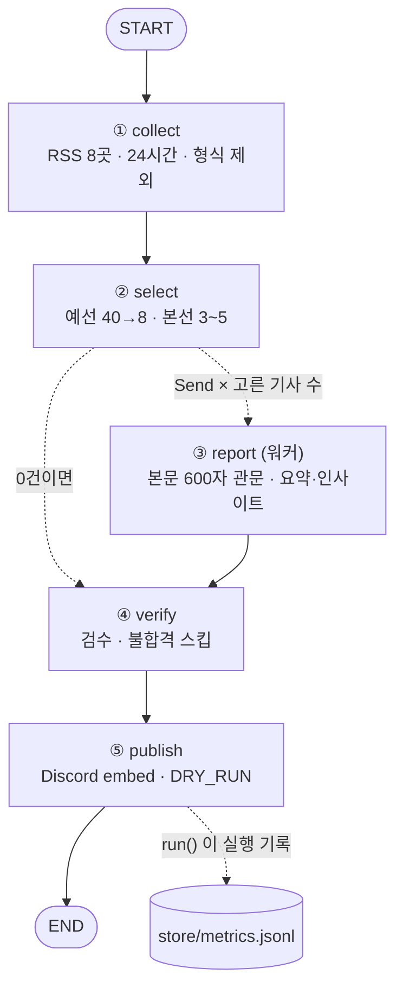

# 비즈 브리핑 — 프로젝트 수행 결과 보고서

기획·재무 의사결정을 위한 경제·기업 뉴스 5건을 매일 아침 골라 Discord로 보내는 LangGraph 에이전트.
레포: https://github.com/rubilisa08/biz-briefing-agent

---

## 1. 분야 및 독자 정의

**분야: 비즈니스 의사결정을 위한 경제·기업 뉴스 (기획 + 재무 융합)**
기업 실적, 산업 변화, 경제지표를 분석하고 기업에 어떤 기회와 위험이 생기는지 설명한다.
예) 삼성전자 실적 변화가 사업 전략에 미치는 영향 · 금리 변화가 기업의 자금 조달에 미치는 영향

**선택 배경**
경제 뉴스는 하루 수백 건이 쏟아지지만, 기획·재무 실무에 필요한 건 "그래서 우리 회사의 매출·비용·자금 조달에 무슨 일이 생기나"이다.
뉴스를 많이 읽는 것보다 **의사결정에 닿는 몇 건을 같은 질문으로 읽는 습관**이 필요하다고 보고 이 분야를 골랐다.

**타깃 독자 페르소나**

| 항목 | 내용 |
|---|---|
| 누구 | 경제·경영에 관심 있는 취업준비생, 주니어 기획·재무 담당자 |
| 직무 | 사업기획, 경영기획, 재무기획(FP&A) |
| 필요 | 아침에 5분 안에 "오늘 기업 환경에 영향을 줄 뉴스"를 파악하고, 면접·보고서에서 쓸 관점을 얻는 것 |
| 핵심 질문 | ① 무슨 일이 일어났는가 ② 왜 중요한가 ③ 기업의 매출·비용·수익성·전략에 어떤 영향을 미칠 수 있는가 ④ 앞으로 무엇을 주목해야 하는가 |

**카테고리 4개** (`audience.yaml`)

| 카테고리 | 다룰 내용 | 핵심 분석 질문 |
|---|---|---|
| 경제 지표 | 금리, 물가, 환율, 소비 | 기업 환경이 어떻게 바뀔까? |
| 기업 실적 | 매출, 영업이익, 현금흐름 | 기업의 수익성은 왜 변했을까? |
| 산업·경쟁 | AI, 반도체, 유통, 금융 | 어떤 기업이 기회를 얻을까? |
| 경영 의사결정 | 투자, 비용 절감, 신사업 | 기업은 어떤 선택을 해야 할까? |

---

## 2. 소스 채택표

**측정 방법** — `scripts/probe_sources.py` 로 후보 15곳에 실제 요청을 보내 잰 값 (원자료: `store/source_probe.json`, 2026-10-29 측정).
과제 제외 목록(OpenAI · DeepMind · TechCrunch · The Verge · MIT TR · AI타임스)은 후보에서 뺐다.

**관문 (채택 기준)**
- **G3 접근**: HTTP 200
- **G2 생존**: 최근 24시간 안 글 5건 이상
- **G1 본문**: 최근 3건 중 2건 이상 본문 600자 이상 추출
- **무료판 조건**: 피드 요약 80자 이상 (현재 발행 요약으로 피드 요약을 쓰기 때문)

| 소스 | HTTP | 피드 건수 | 24h 건수 | 요약 길이 | 최신 글 | 본문 추출 | 판정 | 근거 |
|---|---|---|---|---|---|---|---|---|
| 한국은행 보도자료 | 200 | 100 | 2 | 1,565 | 4.0h | 0/3 | ✅ 채택 (예외) | 금리·물가의 1차 소스. 본문 추출은 실패하지만 피드가 보도자료 전문(1,565자)을 줘서 피드를 본문으로 사용. 건수가 적어 G2 예외 |
| 연합뉴스 경제 | 200 | 120 | 120 | 88 | 0.3h | 2/3 | ✅ 채택 | 전 관문 통과, 경제 지표 기사 비중 높음 |
| 연합뉴스 산업 | 200 | 120 | 120 | 80 | 0.3h | 3/3 | ✅ 채택 | 전 관문 통과, 산업·기업 기사 |
| 매일경제 경제 | 200 | 50 | 36 | 102 | 0.2h | 3/3 | ✅ 채택 | 전 관문 통과 |
| 매일경제 기업 | 200 | 50 | 45 | 101 | 0.0h | 3/3 | ✅ 채택 | 전 관문 통과, 기업 실적·경영 기사 |
| 머니투데이 | 200 | 100 | 100 | 377 | 0.0h | 2/3 | ✅ 채택 | 요약이 길어 무료판 요약 재료로 좋음 |
| 아시아경제 | 200 | 100 | 100 | 299 | 0.0h | 3/3 | ✅ 채택 | 전 관문 통과 |
| 뉴시스 경제 | 200 | 100 | 100 | 907 | 0.3h | 3/3 | ✅ 채택 | 요약이 가장 풍부 |
| 한국경제 경제 | 200 | 50 | 50 | 0 | 0.9h | 3/3 | ❌ 탈락 | 피드 요약 0자 — 무료판에서 발행할 요약이 없음 (LLM 요약 전환 시 재검토) |
| 한국경제 금융 | 200 | 50 | 50 | 0 | 0.1h | 3/3 | ❌ 탈락 | 위와 같음 |
| 조선비즈 | 200 | 100 | 100 | 0 | 0.1h | 2/3 | ❌ 탈락 | 위와 같음 |
| 이데일리 | 200 | 50 | 0 | 202 | 26.3h | 3/3 | ❌ 탈락 | G2 — 24시간 안 0건, 피드 갱신이 늦음 |
| CNBC Economy | 200 | 30 | 3 | 137 | 9.5h | 3/3 | ❌ 탈락 | 영어 — 국내 주니어 독자 대상, 무료판은 번역 불가. 24시간 3건 |
| 한국경제 산업 | 404 | – | – | – | – | – | ❌ 탈락 | G3 — 주소 없음 |
| 정책브리핑 기재부 | 404 | – | – | – | – | – | ❌ 탈락 | G3 — 주소 없음 |

**결과**: 15곳 중 8곳 채택 (1차 소스 1 + 매체 7), 하루 약 550건 수집 (형식 제외 약 40건).
같은 매체를 섹션별로 두 개씩 둔 곳(연합뉴스·매일경제)은 경제/산업·기업 섹션이 다루는 기사가 달라 카테고리 균형을 위해 둘 다 채택했다.

---

## 3. 선별 로직 설계

**중요도 판단 문장** (`audience.yaml` › `importance`)
> 이 뉴스가 기업의 매출·비용·수익성·자금조달·전략 판단을 바꿀 만한가.
> 숫자(지표·실적)로 확인되는 변화일수록, 여러 기업에 동시에 영향을 줄수록 중요하다.

**점수 매기기** (`graph.py` › `classify`)

| 요소 | 점수 | 이유 |
|---|---|---|
| 카테고리 키워드 — 제목에서 | +2 / 개 | 제목에 나온 주제가 기사의 중심 |
| 카테고리 키워드 — 요약에서 | +1 / 개 | 보조 근거 |
| 수치 신호 (%, %p, bp, 조, 억, 달러, 원) | +2 | 중요도 문장의 "숫자로 확인되는 변화" |
| 홍보성 표현 (MOU, 협약, 수상, 기부, 이벤트 …) | −3 | 의사결정 재료가 아님 |
| 제외 형식 ([포토], [부고], [인사], [사설] …) | 수집 단계에서 제외 | 발행 가치가 없는 형식 |

가장 점수가 높은 카테고리가 그 기사의 **카테고리 라벨**이 되고, 걸린 키워드가 **근거 라벨**로 남는다.

**예선 → 본선 2단계** (`select` · `ask_picks`)

```
약 550건 ──40건씩 묶음──▶ 묶음마다 8건 (예선) ──▶ 약 110건 ──한 화면──▶ 3~5건 (본선)
```

| 설정 | 값 | 이유 |
|---|---|---|
| 묶음 크기 `batch` | 40 | 한 번에 비교하는 후보 수. LLM 선별로 바꿨을 때 목록이 길면 가운데 후보를 놓친다(lost in the middle). 40건이면 제목 목록이 한 화면·한 번의 호출에 들어간다 |
| 예선 통과 `prelim_per_batch` | 8 | 최종 5건보다 넉넉히 올려야 본선에서 카테고리·매체 균형을 맞출 여유가 생긴다 |
| 최종 건수 `target` | 5 | 과제 기준 3~5건. 아침 5분 분량 |
| 최저 점수 `min_score` | 3 | 기준에 못 미치는 날엔 억지로 채우지 않는다 (3건 미만도 허용) |
| 매체당 `per_source` | 2 | 한 매체가 지면을 독점하지 않게 |
| 카테고리당 `per_category` | 2 | 네 카테고리를 고루 — 실적 기사만 5건 오는 날을 막는다 |
| 같은 사건 | 1건만 | 제목 낱말이 40% 이상 겹치면 같은 사건으로 보고 한 건만 (예: 같은 회사 3분기 실적을 두 매체가 보도) |

**의도대로 동작했다는 근거** — 실행마다 `store/metrics.jsonl` 에 한 줄씩 남는다.
- `picked`: 고른 기사마다 카테고리 · 점수 · 근거 키워드 · 이유 문장
- `runners_up`: 본선에서 아깝게 떨어진 상위 3건 (왜 떨어졌는지 비교용)
- `excluded`, `dead`, `by_source`: 수집 단계 제외 건수, 응답 없는 소스, 소스별 건수

2026-10-29 실행 예 (로그):
```
② 선별   551 → 예선 112 → 5건
   ✔ [기업 실적] 11점 · 뉴시스 경제 · MS는 25조 흑자·구글은 12조 적자…현금흐름에 주가 엇갈려
   ✔ [기업 실적] 10점 · 아시아경제 · OCI홀딩스, 3분기 영업익 680억원…흑자전환
   ✔ [경제 지표] 10점 · 뉴시스 경제 · 엔화, 日 정책금리 발표 전 지분조정에 1달러=157엔대 후반 출발
   ✔ [경제 지표] 8점 · 아시아경제 · 원·달러 환율, 0.9원 내린 1336.8원(오후 3시30분)
   ✔ [산업·경쟁] 8점 · 머니투데이 · 생보업계, 9월까지 생산적 금융 6.2조 공급 …"미래산업 투자 확대"
```
카테고리당 2건 제한 덕분에 점수가 더 높은 실적 기사(한화솔루션 9점 등)가 `runners_up` 으로 밀리고 산업·경쟁 기사가 들어왔다.
같은 OCI홀딩스 실적을 다룬 다른 매체 기사는 같은 사건 규칙으로 빠졌다.

---

## 4. 파이프라인 구조도



**State 흐름** (`graph.py` › `Brief`)

| 칸 | 쓰는 노드 | 읽는 노드 | 합치는 법 |
|---|---|---|---|
| `collected` | collect | select | 덮어쓰기 |
| `stats` | collect | (기록) | 덮어쓰기 |
| `picked`, `runners_up` | select | report, (기록) | 덮어쓰기 |
| `drafted` | report × N | verify | **이어 붙이기** (`operator.add` — 워커 여럿이 동시에 씀) |
| `verified`, `checks` | verify | publish, (기록) | 덮어쓰기 |
| `published` | publish | (기록) | 덮어쓰기 |
| `log` | 모든 노드 | (기록) | **이어 붙이기** |

자동 실행: GitHub Actions(`.github/workflows/daily.yml`)가 매일 22:30 UTC(= 07:30 KST)에 `run.py` 를 실행하고, 실행 기록을 레포에 커밋한다.
`scripts/trace_run.py` 는 실제 그래프에서 구조도를 뽑아 [`WORKFLOW.md`](WORKFLOW.md)를 갱신하고, 노드 실행 순서가 설계와 같은지 자동 판정한다.

---

## 5. 실행 기록

> 📷 **여기에 Discord 발행 화면 캡처를 넣어 주세요.** (예: `docs/discord.png` 로 저장 후 ``)

**GitHub Actions 실행 로그 (발췌)**
```
(첫 실제 발행 후 Actions 로그를 붙여 넣습니다)
```

**검수 기록** — `store/metrics.jsonl` 의 `checks` 칸에 초안마다 통과 여부와 문제점이 남는다.

---

## 6. 프로젝트 회고

**가장 공들인 부분**
- **소스를 숫자로 고른 것** — "괜찮아 보이는 곳"이 아니라 응답·건수·요약 길이·본문 추출률을 재서 15곳 중 8곳을 골랐다. 한국경제·조선비즈처럼 유명한 매체도 피드에 요약이 없어서 탈락했고, 반대로 본문 추출이 안 되는 한국은행은 피드 전문을 쓰는 예외로 살렸다.
- **선별 근거를 남기는 것** — 고른 기사마다 카테고리·점수·근거 키워드를, 떨어진 후보도 함께 기록해서 "왜 이 5건인가"를 나중에 확인할 수 있게 했다.
- **조용한 실패 막기** — 발송이 실패하면 실행이 실패로 끝나고, 고른 기사가 0건이어도 "조용한 날" 카드는 보내며, 응답 없는 소스는 로그에 남는다.

**향후 보완하고 싶은 점**
- **요약·인사이트·환각 검수를 LLM으로** — 지금은 무료판이라 요약은 매체 피드 요약, 인사이트 칸은 카테고리 분석 질문과 근거 키워드다. Gemini API(무료 등급)를 붙여 `draft` 가 핵심 질문 네 가지에 답하게 하고, `check` 가 요약을 원문과 대조해 불합격이면 한 번 다시 쓰고 그래도 안 되면 버리도록 바꿀 예정이다. 함수 세 개(`ask_picks`, `draft`, `check`)만 갈아 끼우면 되도록 구조를 나눠 두었다.
- **키워드 선별의 한계** — 맥락을 읽지 못해 "AI" 같은 넓은 키워드에 끌려가는 기사가 있다. LLM 본선 비교로 보완한다.
- **공시·지표 데이터 연결** — DART 전자공시(실적), 한국은행 ECOS(지표) API를 붙이면 기사 속 숫자를 원자료로 확인할 수 있다.
- **예약 실행 지연** — GitHub 예약 실행은 몇 분~몇 시간 늦을 수 있어, 실제 도착 시각을 보고 예약 시각을 조정한다.
